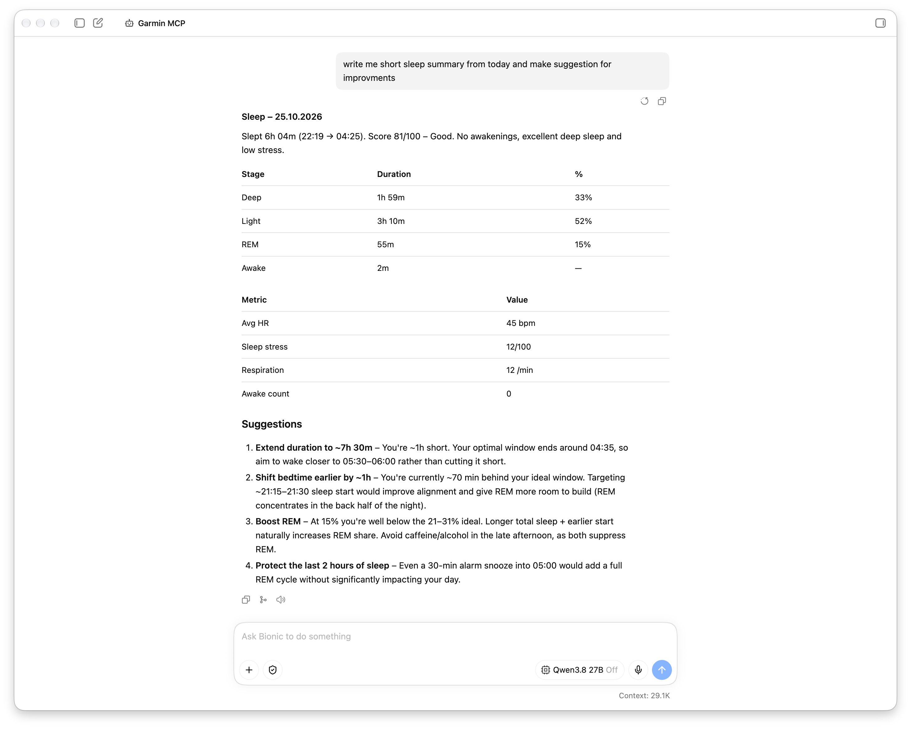

# Garmin Personal Data MCP

An MCP (Model Context Protocol) server that connects AI assistants to Garmin Connect personal data, enabling natural-language access to fitness activities and health and performance metrics.

## Overview

This project provides a bridge between Garmin Connect personal data and MCP-compatible AI applications. It allows an assistant to retrieve and analyze supported Garmin data through tools, without requiring the user to manually browse or export records.

## Available Tools
- get_activities
- get_daily_sleep

## Example Usage

Tested with model **qwen/qwen3.8-27b**



## Development

### Build
```
make build
```

### Run
```
API_KEY=$(op://Private/Garmin/Token) ./garmin-mcp
```

### Tests

```
{"jsonrpc":"2.0","id":1,"method":"initialize","params":{"protocolVersion":"2025-03-26","capabilities":{},"clientInfo":{"name":"cli","version":"1.0"}}}
{"jsonrpc":"2.0","method":"notifications/initialized"}
{"jsonrpc": "2.0","id": 2,"method": "tools/call","params": {"name": "get_activities","arguments": {"start": 0,"limit": 20}}}
```
